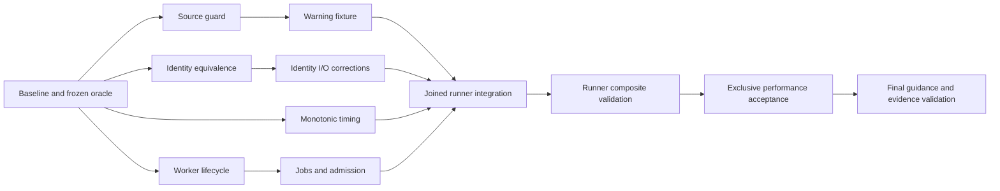

# Contract validator runtime plan

Closure: the owner closed this task on 2026-11-06 after PR #79 merged. The plan and
atomic statuses below are historical evidence, not an active queue. Warning-prefix,
identity-scan and bounded-guard changes are integrated; timing, acceptance concurrency,
the additional scanner output-I/O correction and comparative targets remain undelivered.
See the source-backed Implementation review in the specification. Closing the task did
not promote unfinished criteria or validation phases to passing.

Scope: one spec phase, W1-W5. W6/W7 remain deferred. PRs #77 and #78 delivered partial implementation and test reductions to `main`; the rows below retain their prior statuses until their individual criteria and atomic checkpoints are reconciled. The complete validator passed in 568.838 seconds on the tested PR #78 parent; this is not comparative performance acceptance.

Resume amendment: start with the T-01 checkpoint reconciliation described in `state.md`, then reconcile already merged work for T-02 through T-05 before undertaking remaining work. Preserve the existing decomposition. The owner requires at most 15 minutes of testing and no long, heavy or large tests: repeated B/S/P baseline and median gates below are historical and superseded where they conflict with that limit. Keep their evidence diagnostic, disclose unmet comparisons, and run any full validation exclusively within the limit. Timing, worker lifecycle, scheduler integration and final task validation remain unfinished.

## Subtasks

| ID | Name | Type | Key Steps (summary) | Depends On | Parallel lane | Status |
|----|------|------|---------------------|------------|---------------|--------|
| T-01 | Freeze the implementation equivalence oracle | leaf | freeze current payload → pin oracle/resources → measure B | — | baseline / exclusive runs | not-started |
| T-02 | Implement the bounded nested-run source guard | leaf | inventory references → RED mutations → bounded scanner | T-01 | guard | not-started |
| T-03 | Replace complete warning-fixture runs with the guarded prefix | leaf | record fixture amendment → trim real prefix → register guard | T-01, T-02 | guard | not-started |
| T-04 | Optimize successful identity scans against the frozen corpus | leaf | pin scanner rows → per-file matching → differential verification | T-01 | identity | not-started |
| T-05 | Reject incomplete identity-scan I/O | leaf | RED I/O faults → propagate failures → retain equivalence | T-04 | identity | not-started |
| T-06 | Add opt-in timing around complete result evaluation | leaf | RED clock boundary → opt-in timing → consumer checks | T-01 | timing | not-started |
| T-07 | Run acceptance groups with bounded owned concurrency | composite | (children: T-07a, T-07b, T-07c) | T-01 | composite join / coordinator | not-started |
| T-07a | Contain and reap complete worker process trees | leaf | RED descendant trees → containment → signal/fault cleanup | T-01 | lifecycle | not-started |
| T-07b | Validate jobs and schedule productive bounded slots | leaf | RED jobs/admission → bounded slots → exclusive/refill proof | T-01, T-07a | lifecycle | not-started |
| T-07c | Integrate original expressions and ordered output | leaf | original expressions → record-based ordered replay → barriers/consumers | T-01, T-02, T-03, T-04, T-05, T-06, T-07a, T-07b | serial integration | not-started |
| T-08 | Complete performance acceptance and operating guidance | composite | (children: T-08a, T-08b) | T-01, T-02, T-03, T-04, T-05, T-06, T-07 | composite join / coordinator | not-started |
| T-08a | Measure the complete optimized validator against the baseline | leaf | stable real runs → exact medians/budgets → acceptance record | T-01, T-02, T-03, T-04, T-05, T-06, T-07 | measurement / exclusive | not-started |
| T-08b | Document the verified validator behavior and decisions | leaf | RED documentation contracts → verified guidance → ADR/memory | T-01, T-02, T-03, T-04, T-05, T-06, T-07, T-08a | docs finalization | not-started |

## Execution Strategy

Use the dependency DAG and the task-local parallel policy below. Table position is a display
order, not a global sequential barrier. Within each lane, prerequisites remain sequential;
independent ready lanes may run concurrently in isolated candidates. Composite rows are join
conditions owned by the orchestrator, not additional implementation workers.

The owner explicitly requested parallel subagent execution planning on 2026-11-05. For this
task only, this policy overrides the sequential-only wording in `rules/orchestration.md`,
`workflows/spec-run.md` and the original Discovery execution strategy. It does not change
shared-state formats, global workflows, other tasks, frozen tests or acceptance requirements.
All canonical RED/characterization, independent validation and phase gates remain mandatory.

1. Complete T-01 on the stable integrated payload before any implementation track starts.
   Its read-only inventory/characterization preparation may be delegated as described below;
   unchanged full baseline measurements require a quiet host and immutable measured source.
2. After T-01, run ready guard (T-02 -> T-03), identity (T-04 -> T-05), timing (T-06), and
   lifecycle (T-07a -> T-07b) lanes concurrently, subject to worker slots and resource locks.
   Release a successor as soon as its own prerequisites are integrated and reviewed; do not
   wait for unrelated tracks or an entire wave to finish.
3. Keep each worker's source/tests private. A single integration writer applies candidate
   patches, owns the shared validator/fixtures and records all state/plan/knowledge deltas.
   Reconcile common edits, source-guard references and timing/renderer interfaces before
   accepting a candidate on the integration tree.
4. Once T-02, T-03, T-04, T-05, T-06, T-07a and T-07b are integrated and reviewed, run T-07c
   on that joined revision. Finish composite T-07 integration validation before measurement.
5. Run T-08a with all other host workers idle. Retain every B/S/P sample and both individual
   check measurements; source drift or missed binding budgets leaves acceptance incomplete.
6. Finalize T-08b only after measured evidence exists. Read-only documentation drafts may be
   prepared earlier, but cannot claim measurements or completion. Its added execution-bearing
   checks require any affected full correctness/performance comparisons to be repeated before
   closing. Finish the T-08 composite against the final verified payload and guidance.

This edit schedules future execution only. It creates no worker, checkout, branch, commit,
PR, deployment or settings change. Model selection remains optional and unassigned.

## Parallel Execution

### Dispatch policy

```yaml
parallel_execution:
  authorization: task_specific_owner_request_2026_11_05
  mode: isolated_candidates_with_serial_integration
  max_concurrent_workers: 3
  ready_when: all_dependencies_integrated_and_reviewed
  refill_policy: dispatch_ready_work_when_a_slot_is_free
  shared_state_writer: orchestrator_only
  shared_source_writer: one_integration_writer_at_a_time
  benchmark_lock: exclusive_host_all_other_workers_idle
  deadline_test_lock: exclusive_host_all_other_workers_idle
  full_suite_lock: exclusive_host_all_other_workers_idle
  fallback_without_isolation: serial_execution
```

Three workers leave one slot for the orchestrator in a four-slot session. Clamp this to the
currently available worker slots and machine resources; use fewer workers when necessary.
The ready set initially has four tasks, so one queues until a slot frees. Do not oversubscribe
the session or assume a specific model can be launched. Read-only reviewers/support workers
consume the same worker budget. A composite parent consumes no worker slot by itself.

### Work eligibility and ownership

| Work item | Earliest release | Parallel work allowed | Shared integration boundary / completion gate |
|-----------|------------------|-----------------------|-----------------------------------------------|
| T-01 | Start | Before measurement, delegate read-only result/expression inventory, validator-reference/resource inventory, and characterization scenario preparation into separate report outputs. | One T-01 owner consolidates/freezes the oracle. Baseline full runs are exclusive; no implementation starts until T-01 is reviewed. |
| T-02 | T-01 reviewed | Implement the bounded source guard and its unique guard fixtures alongside identity, timing and lifecycle lanes. | Own guard classifier/function and exact exception data; no top-level registration until T-03. Return changes to common fixture data for serial application. |
| T-03 | T-02 integrated/reviewed | Implement the warning-prefix fixture and its unique tests while other lanes continue. | Own warning-fixture function and guard registration; preserve three assertions and record the fixture amendment. Source-guard GREEN is required before closure. |
| T-04 | T-01 reviewed | Optimize the identity hot loop against the pinned corpus alongside guard, timing and lifecycle work. | Own successful-input scanner implementation/tests. Shared ledger discovery/masking/knowledge logic stays frozen. |
| T-05 | T-04 integrated/reviewed | Add scanner I/O RED corrections while guard, timing or lifecycle work continues. | Same scanner and identity fixture file as T-04: these two tasks never write concurrently. Keep new failure expectations separate from pinned equivalence. |
| T-06 | T-01 reviewed | Implement/prove the timing adapter and unique timing fixtures alongside guard, identity and lifecycle work. | Own timing setup/hooks and renderer timing changes; preserve literal checks/extracted consumers. Final worker-clock wiring belongs to T-07c. |
| T-07 | T-01 reviewed | Track lifecycle children while unrelated feature lanes run. | Coordinator-only rollup; completion waits for all children and the joined T-07 integration verdict. |
| T-07a | T-01 reviewed | Implement the ownership/record lifecycle with tiny synthetic trees alongside other feature lanes. | Own lifecycle portion of the inline supervisor and process fixtures. Deadline/signal/resource cleanup assertions use the exclusive-host lock. |
| T-07b | T-07a integrated/reviewed | Implement jobs/admission/refill/exclusivity using the reviewed lifecycle interface while guard/identity/timing work continues. | Own scheduler portion of the same inline supervisor. Never edit it concurrently with T-07a. Do not duplicate T-06 timing or T-07c reporting logic. |
| T-07c | All feature/lifecycle dependencies integrated/reviewed | Optional independent read-only mapping/consumer reviews may overlap on immutable snapshots, within the worker budget. | Serial final integration of original expressions, timing, ordered records and snapshot barriers. No concurrent writer to its integration tree; real/full/deadline verification holds its required host lock. |
| T-08 | T-07 and remaining dependencies reviewed | Read-only evidence/document consistency preparation only. | Coordinator-only rollup; both children plus final composite validation must pass. |
| T-08a | T-07 and remaining dependencies reviewed | No concurrent host work during any measurement or controlled acceptance sample. | Exclusive B/S/P/individual-check measurements on immutable source. Other workers must acknowledge idle before the lock is granted. |
| T-08b | Final execution after T-08a reviewed | Earlier draft-only delegation is allowed after T-01 for jobs/timing/cleanup guidance and documentation-test proposals, with unknown measurements left explicit. | Publish measured values and finalize only after T-08a; coordinator applies shared docs/ADR/memory deltas. Repeat affected acceptance after new checks. Draft work cannot mark the task done. |

These are all concurrency opportunities in the current decomposition. There is no producer/consumer
parallel implementation across T-02 -> T-03, T-04 -> T-05, or T-07a -> T-07b; their same-component
handoffs require reviewed code. The final T-07c/T-08 gates remain joins, not independent tracks.

### Ready sets and join points

| Stage | Ready work / release condition | Barrier |
|-------|--------------------------------|---------|
| Bootstrap | T-01 preparation reports may be collected concurrently. | Freeze the complete oracle; all other workers idle for unchanged B runs; review T-01. |
| Independent tracks | T-02, T-04, T-06, T-07a become ready together. | At most three workers; dispatch queued ready work when a slot frees. |
| Lane successors | T-03 after T-02; T-05 after T-04; T-07b after T-07a. | Each predecessor is integrated and reviewed; unrelated lanes need not finish. |
| Joined runner | T-07c after all feature/lifecycle dependencies are integrated and reviewed. | Complete T-07 composite validation on the joined revision. |
| Measurement | T-08a after T-07 and remaining prerequisites are reviewed. | Exclusive host and stable source/config/cache policy; no competing agent computation/tests. |
| Final guidance | T-08b finalization after T-08a, then T-08 composite validation. | Measurements must match the final execution-bearing payload; repeat affected comparisons. |



### Candidate isolation and file ownership

- The orchestrator prepares each worker a private candidate checkout/snapshot at an identified
  base revision containing its reviewed prerequisites. A plain copy lacking required Git history
  and index state is not valid for full-validator acceptance. Keep real HOME/XDG/log stores isolated.
- Never run parallel workers against the same mutable source tree, even when they intend to edit
  different regions of `scripts/validate-contracts.sh`. Private candidates may each change that
  path; only one integration writer may update the shared path at a time.
- `scripts/validate-contracts.sh` ownership is partitioned by the component boundaries above.
  Helpers shared across components require a coordinator-approved interface before use. T-07b
  consumes T-07a's reviewed record/lifecycle interface; T-07c consumes those and T-06's timing
  interface. Do not create competing copies of common helpers or incompatible record schemas.
- Unique fixture files belong to their task: guard, warning, identity, timing, processes, scheduler,
  integration and characterization respectively. T-04 -> T-05 share the identity fixture serially.
  The frozen corpus under `tests/fixtures/validator-runtime/` is read-only to workers; new fixture
  entries are returned as uniquely named proposed additions for the integration writer.
- Only the orchestrator writes `state.md` (including every leaf progress block), `plan.md`, memory,
  ADRs/index and the shared runbook/usage documents. Subagents return proposed deltas instead of
  writing these files, even where ordinary child instructions permit an own-block write.
- Keep provisional documentation drafts and agent reports outside the shared checkout. They cannot
  change source-guard inventory, identity results or the measured payload while a run is active.
- Workers perform no git mutations, rebases, branch switching, commits, pushes or PR operations.
  If later execution uses worktrees/branches, their lifecycle and integration belong solely to the
  orchestrator within that execution's existing authorization; this planning edit grants none.

### Subagent dispatch and return contract

For every dispatch, include the task description, immutable input/base identity, dependency verdicts,
component-owned source regions, unique fixture paths, frozen oracle location, applicable resource
locks, scope/TDD mode and the explicit prohibition on shared-state/git writes. Supply interfaces
from actual reviewed predecessors, not another running worker's mutable source.

Each worker returns:

1. Task ID and exact base/candidate source identities; changed paths/regions and patch or candidate
   location. No automatic application to the integration checkout.
2. Preserved characterization or observed RED digest, frozen test identities and results; new
   behavior cannot be relabeled characterization. Pause at required RED review/commit gates.
3. GREEN evidence, exact commands/exits and candidate identity, separated from work still pending
   an exclusive-host lock. Targeted probes supplement, rather than replace, required test-command
   gates, real consumer checks or complete performance acceptance.
4. New source-guard references/exception proposals, result-inventory additions and any common
   interface or fixture changes that require reconciliation. No broad exemptions or test weakening.
5. Proposed status/target-file/TDD/amendment/knowledge deltas, unresolved blockers and needed
   integration checks. A finished report does not itself change canonical task status.

The orchestrator serially checks each returned base and scope, applies the test/implementation
changes through the required test-first/git gates, resolves overlapping hunks without weakening
frozen tests, and rechecks the changed component on the joined tree. Integration may be delegated
to one designated integration worker while the orchestrator retains all shared-state/git writes.
If the candidate's base or a required interface changed, obtain a refreshed patch and rerun affected
checks. Use a separate Validator on an immutable candidate; a validator may run alongside other
isolated implementation work only when it holds the required resource locks. Mark a dependency
reviewed only after applicable integrated evidence and independent validation are accepted.

### Resource locks and recovery

| Resource | Concurrency rule | Release condition |
|----------|------------------|-------------------|
| Worker slots | Shared, maximum three active support/implementer/validator workers and available runtime slots. | Worker returns or is explicitly stopped. |
| Integration source | Exclusive writer; other workers use private candidates. | Patch reconciliation and affected checks finish. |
| Shared planning/knowledge/git | Orchestrator only, serial writes. | Canonical delta is applied and verified. |
| Full validator / real acceptance groups | Exclusive host; other workers acknowledge idle. | Entire owned process tree is reaped and temporary outputs removed. |
| Deadline/signal/timing-sensitive verification | Exclusive host; no competing worker computation. | Controlled case finishes and PID/output cleanup is verified. |
| Baseline/optimized/individual performance sample | Exclusive host plus immutable measured source/config; no integration or draft publication during the window. | Sample records are finalized outside measured source and all processes reaped. |
| Fast deterministic unit/differential/static checks | Parallel in private candidates when they do not exercise wall deadlines, spawn heavy suites or share stores. | Candidate-local command finishes. |

Before granting an exclusive-host lock, stop dispatch, ask active workers to checkpoint/pause and
wait for acknowledgement plus actual process drain. A pending instruction is not proof of idle.
If a required lock cannot be acquired, keep that verification pending; do not report a pass or
run a contaminated sample. Resume ready work after release.

A failed lane blocks its descendants, not unrelated ready lanes. Cancel dependent dispatches,
retain RED/characterization evidence and let independent work continue where locks permit.
On a stale base, overlapping shared edit, unexpected common dependency or unavailable isolation,
serialize the affected work and update the dispatch decision; never permit concurrent shared writes.
Keep successful candidate evidence, but rerun every check invalidated by reconciliation. No phase
or composite is complete until all required lane joins and acceptance gates actually pass.

## Decomposition Decisions

The spec suggests seven implementation units. Its scheduling/cleanup and documentation/measurement
units each contain independent verification clusters, and the scanner has explicitly distinct
preserved behavior and new error handling. Eight top-level units with two depth-2 composites retain
coherent atomic cycles: 11 leaves and 2 composites (13 descriptions), rather than merging unrelated
outcomes or hiding a new behavior correction in characterization.

| Subtask | Decision | Signals | Rationale |
|---------|----------|---------|-----------|
| T-01 | leaf | S1=6, S2=1, S3=1, S4=false, S5=1 | One frozen oracle supplies the source/result/resource provenance consumed by every optimization. |
| T-02 | leaf | S1=6, S2=1, S3=1, S4=false, S5=1 | A single source-classification component has its own mutation oracle and can reject unsafe source before runtime integration. |
| T-03 | leaf | S1=6, S2=1, S3=1, S4=false, S5=1 | One history-fixture construction change removes recursive work while preserving its three warning assertions. |
| T-04 | leaf | S1=6, S2=1, S3=1, S4=false, S5=1 | Successful byte/path/ledger semantics form one equivalence component; new failure handling is a separate RED cycle. |
| T-05 | leaf | S1=5, S2=1, S3=1, S4=false, S5=1 | New scan error semantics require their own observable RED set rather than an equivalence claim. |
| T-06 | leaf | S1=6, S2=1, S3=1, S4=false, S5=1 | One timing adapter must prove its expansion boundary and output compatibility before scheduler integration. |
| T-07 | composite (Type 2) | S1=0 (delegated), S2=3, S3=3, S4=false, S5=3 | Lifecycle ownership, admission policy and Bash reporting integration are three independently testable components with three criteria clusters. |
| T-07a | leaf | S1=6, S2=1, S3=1, S4=false, S5=1 | Worker lifecycle has a standalone PID/cleanup oracle independent of scheduling and report policy. |
| T-07b | leaf | S1=6, S2=1, S3=1, S4=false, S5=1 | Admission decisions are one deterministic scheduling component using the already tested lifecycle interface. |
| T-07c | leaf | S1=7, S2=1, S3=1, S4=false, S5=1 | One Bash adapter maps the frozen acceptance expressions onto the scheduler without changing their externally observed result stream. |
| T-08 | composite (Type 2) | S1=0 (delegated), S2=2, S3=2, S4=false, S5=2 | Controlled performance acceptance and delivered operating documentation have separate verifiable outcomes; the parent checks their agreement. |
| T-08a | leaf | S1=6, S2=1, S3=1, S4=false, S5=1 | One controlled acceptance record decides whether the runtime objective was achieved on the actual payload. |
| T-08b | leaf | S1=5, S2=1, S3=1, S4=false, S5=1 | Operating guidance is one documented interface checked against the actual delivered runtime and acceptance evidence. |

Boundary alternatives scored under the Autonomous Decision Protocol (1-5; higher is better):

| Variant | Simplicity | Reversibility | Codebase fit | Testability | Blast radius | Total |
|---------|------------|---------------|--------------|-------------|--------------|-------|
| Seven flat units, mixed scanner TDD and large runner/evidence leaves | 4 | 4 | 2 | 2 | 4 | 16 |
| Eight top-level units, separate scanner error cycle, two composites | 4 | 5 | 5 | 5 | 4 | 23 |
| Eleven flat leaves without integrated parent ownership | 3 | 4 | 4 | 4 | 4 | 19 |

Winner: eight top-level units with two composites (23/25). Evidence: rules/tdd.md requires
separate RED for behavior correction; the canonical leaf-health classifier requires S2=S5=1;
REQ-12/13 and AC-09/12 require integrated lifecycle/barrier and evidence/document consistency.
Anti-overengineering check passed: composites represent current stated obligations and use existing
workflow formats; there is no new cross-repository contract or Type 3 re-slice.


### Parallel planning amendment — 2026-11-05

The owner requested that all work suitable for parallel subagents be marked for an AI orchestrator.
The decomposition, scope, criteria, statuses and 13-description inventory stay unchanged. Dependency
changes remove sequencing imposed by the initial single-worker schedule rather than inventing new
independence. The original classifier/scoring record above remains historical evidence.

| Changed dependency | Reason it can be removed or moved |
|--------------------|-----------------------------------|
| T-04 no longer waits for T-03 | The spec explicitly allows W1/W2 independently after characterization; separate private candidates remove the shared-validator write conflict. |
| T-06 no longer waits for T-03/T-05 | Clock boundary/renderer proof uses the frozen original check semantics and synthetic checks. Final combined scanner/warning/worker behavior is joined in T-07c. |
| T-07a no longer waits for T-02/T-03/T-06 | Process ownership/record cleanup is verified against tiny synthetic workers and needs neither warning optimization nor timing instrumentation. |
| T-07b no longer waits for T-02/T-03/T-06 | Jobs/admission consumes the reviewed lifecycle interface; guard/timing/real-expression integration belongs to T-07c. |
| T-07 parent depends only on T-01 | It can track lifecycle children early. Child T-07c now explicitly requires the full guard, warning, scanner, timing and lifecycle join; parent completion still requires all children plus composite validation. |
| T-07c explicitly waits for T-04/T-05 | The final runner/guard/snapshot validation must use the joined scanner source before the performance gate. |

Retained strict edges: baseline before all implementation; guard before warning registration;
scanner equivalence before error correction; lifecycle before admission; all tracks before runner
integration/composite validation; valid measurement before final measured guidance. Private drafts
are preparation only and never satisfy these dependencies.

## Acceptance Coverage

| Spec acceptance | Owning leaf / integration parent |
|-----------------|----------------------------------|
| AC-01 | T-03 |
| AC-02 | T-03, T-08a, T-08 |
| AC-03 | T-01, T-04, T-05 |
| AC-04 | T-04, T-08a |
| AC-05 | T-01, T-07c, T-07, T-08a |
| AC-06 | T-07a, T-07b, T-07 |
| AC-07 | T-02, T-03 |
| AC-08 | T-06, T-07c |
| AC-09 | T-01, T-08a, T-08 |
| AC-10 | T-01, T-03, T-07c, T-08a |
| AC-11 | T-01, T-06, T-07c, T-07, T-08b |
| AC-12 | T-08b, T-08 |
| AC-13 | T-07b, T-07 |
| AC-14 | T-07a, T-07c, T-07 |
| AC-15 | T-01, T-07b, T-07c, T-07, T-08a |
| AC-16 | T-01, T-06, T-07b, T-07c, T-07 |
| AC-17 | T-05 |

Performance acceptance remains external evidence; no ordinary-suite wall-time threshold is added.
Every new ordinary runtime/guard result gets one declared name and one place in the frozen delta.
