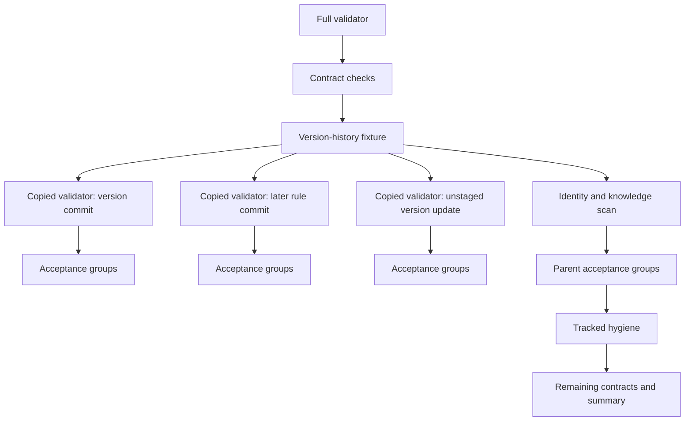

# Validator runtime specification review — 2026-11-05

## Request and scope

The owner requested an examination of the runtime specification and current tests,
correction of any errors, and repeated independent validation after each revision
until the score reaches at least 9.5/10. The owner reports test runs of 50 minutes
or longer. This review changes the specification and its supporting knowledge only.
The optimizations are not implemented.

Specification: [Contract validator runtime](../../.ai/specs/06-1-test-suite-runtime.md).
Inspected HEAD: `672cd514ade50e0207b839ba424222701771a5fa`.
Inspected validator: blob `d64c4a413e7be1114df51bdbc67ffd0b6ad75709`, 5,796 lines.
Existing unrelated working-tree changes were preserved.

## Current execution model

The test command and sync preflight execute the same Bash validator. Thirty-seven
focused flags dispatch before the no-argument full-run path. Some dispatch by exec,
some loop and some combine multiple files. A focused flag is not a universally
interchangeable implementation of a full-run acceptance group.

The full run emits the optional version warning, evaluates contract checks and
fixtures, runs 36 acceptance groups sequentially, executes tracked hygiene, then
continues through 80 additional static Bash check call sites before its summary.
Two of those 80 calls are inside loops. Static call sites, runtime outer result
records, test files and generated unittest cases are different inventories.

The main result function receives an already evaluated result string. Its own
function-body duration excludes most test work. Result strings can contain multiline
failure excerpts, and test output must not be parsed as authoritative counters.

The version-history fixture copies the checkout, removes six groups and runs the
remaining validator three times. Each copy still runs the expensive acceptance
suites. The parent runs them again. Thus an increase in an included suite's runtime
is paid four times in a full run, subject to fixture-specific differences.

The diagram shows call ownership; the three nested full runs execute sequentially.

The proposed trimmed fixture observes the same warning function and real git history
without executing copied checks. It intentionally stops asserting that every other
validator check succeeds in a fresh history-less copied checkout. The specification
now names this narrow fixture amendment rather than claiming universal equivalence.

## Inspection evidence

- Inspected entrypoint dispatch, check/result construction, run-log mutation/harness
  extraction, version fixture, identity ledger and scan, all acceptance wrappers,
  post-hygiene contracts and sync preflight.
- AST-Grep found 507 Bash check call sites overall and 80 after tracked hygiene;
  ordinary column-zero text matching misses the two indented loop bodies.
- Static AST inventory parsed all 142 test files, including embedded Python programs
  where applicable: 130 usage Python files, 4 model Python files, 1 workflow Python
  file and 7 shell files. Reusable fixture modules are included in these counts.
- Static named test-function/method counts: 894 usage, 87 model and 332 in embedded
  shell acceptance programs. Generated table methods and subtests expand runtime
  counts; these static counts are not a runtime coverage claim.
- Fixture roots, subprocess sites, shared-module imports and direct source-root write
  expressions were inspected. No direct mutation expression rooted at SOURCE/ROOT
  was found; dynamic alias effects and concurrency safety still require the specified
  resource inventory and runtime acceptance.
- Confirmed the isolated run-log harness's exact section markers, two-line check
  extraction, literal mutation target and PYCORRELATED annotation consumer.
- Confirmed focused/full differences: publication's focused path includes legacy
  recovery; model-workflow's focused path combines other model suites. Full wrappers
  have generic-only, 20-, 35- and 60-line diagnostic conventions.

## Executed checks

### Current git-rails suite

Command: `PYTHONDONTWRITEBYTECODE=1 /usr/bin/time -v bash scripts/validate-contracts.sh --git-rails-only`.
Output and timing were captured under `/tmp` during this review.

| Measure | Result |
|---|---:|
| Runtime unittest cases | 2,346 |
| Failures | 0 |
| Unittest seconds | 287.877 |
| Wall seconds | 288.15 |
| User seconds | 194.31 |
| System seconds | 84.53 |
| Maximum RSS, KiB | 65,920 |
| Exit status | 0 |

Environment: 8 usable CPUs, Linux 7.0.0-42-generic, Python 3.14.4, Bash 5.3.9,
GNU grep 3.12, LANG=en_US.UTF-8 and LC_CTYPE=C.UTF-8, approximately 15 GiB RAM.
The standard inspected cgroup limit files were unavailable. No other validator ran
concurrently. This is one focused sample, not a current full baseline or proof of
optimized runtime. It already exceeds the old 240-second full-run stretch goal.

### Small isolated probes

1. A real current validator prefix cut after the unique warning call, with minimal
   source files and isolated git history, produced no warning / warning / no warning
   for the required three states. All exits were 0; no copied result line appeared.
   Each invocation took about 0.01–0.02 seconds. This proves feasibility only, not the
   complete before/after history-fixture acceptance.
2. A NUL-split identity was found by the original Bash read loop but missed by raw
   file-level grep. Normalizing NUL bytes restored exact line/token output, including
   repeated tokens, preserved case and an unterminated final line.
3. Reading `/proc/self/mem` through the original while-loop shape emitted an I/O error
   yet ended with `loop_status=0 lines=0`. Fail-closed read-error handling is therefore
   new behavior and must have separate RED coverage, not false equivalence claims.
4. Inspected the existing `setsid sleep 6` fixture and the core's new-session git
   subprocesses. Worker-group-only cleanup cannot establish descendant cleanup;
   the revised contract requires verified ownership beyond process-group boundaries.
5. Requirement/acceptance identifiers are unique; traceability covers all active
   requirements. Whitespace verification passes. Runtime/test/hook sources are
   unchanged by this review.

A new 34–52-minute full validator run was not performed during this prose review.
The specification requires controlled complete baseline and optimized measurements
for future implementation acceptance.

## Independent review cycles

| Version | Independent score | Outcome |
|---|---:|---|
| Original | 7.0/10 | Historical workload drift, invalid monotonic clock, coverage/count contradictions, NUL semantics, inaccurate diagnostics and incomplete scheduling/cleanup acceptance. |
| Revision 2 | 9.3/10 | Remaining read-error equivalence contradiction and missing explicit escaped-session interruption case. |
| Revision 3 | 9.6/10 | Ready for development; corrected changed-line totals versus net growth and clarified timing-off dependencies in the following revision. |
| Revision 4 | 9.7/10 | Ready for development; no blocking contradictions or factual errors found. |

The final validator reviewed specification SHA256
`8ba90d63217b935e827eda05ce0c45e8b0d51e26aa9c4e9d4e0285c392ebd4ff`.
The requested independent score threshold is satisfied. Implementation performance
and correctness remain future acceptance obligations.

Each revision was followed by a separate independent read-only validator. No reviewer
edited the specification; the primary writer applied changes.

## Resulting implementation contract

- Remove unnecessary complete warning-fixture runs using a guarded minimal real prefix.
- Replace per-line matching forks while preserving the existing ledger, byte handling,
  locale and knowledge checks; name the new fail-closed error behavior separately.
- Preserve all existing full-run acceptance expressions, diagnostics and result order.
- Default to at most four usable-CPU-bounded groups, retain jobs=1, and classify timing
  or resource conflicts for serialization without weakening assertions.
- Join all workers before tracked hygiene and preserve every later contract check.
- Contain/reap escaped descendants, including the existing setsid scenario; do not
  depend on Python fixture cleanup after abrupt termination.
- Use genuine monotonic timing beginning before argument evaluation.
- Detect accidental recursive full runs with an inventoried, bounded source guard;
  explicitly avoid claiming general shell/security-parser coverage.
- Measure proportional improvement against current controlled full baseline B; keep
  the old 360/240-second whole-run targets as separately reported stretch goals.

No optimized-runtime claim is made until the implementation and its acceptance
measurements are complete.
